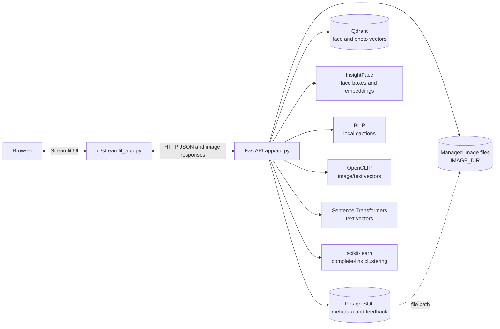
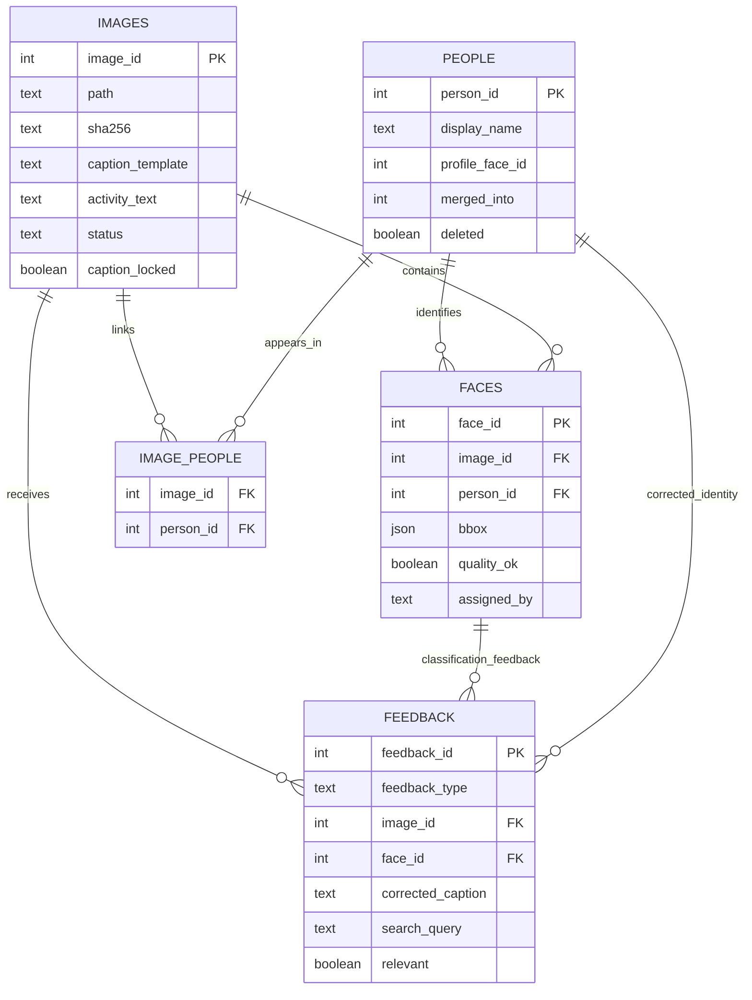
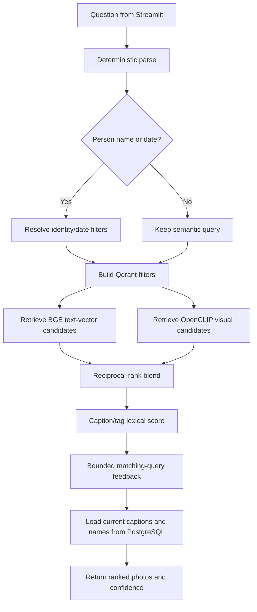

# Lumen architecture and workflow

This document describes the current implementation: what runs in each service, where each kind of data lives, and how an image moves through the system.

## System map



The browser does not connect directly to PostgreSQL or Qdrant. Streamlit calls FastAPI; FastAPI coordinates storage and local model inference. PostgreSQL and Qdrant run as Docker Compose services by default, while the Python app runs on the host.

## Responsibilities by component

| Component | Responsibility | Persistent data |
|---|---|---|
| Streamlit (`ui/streamlit_app.py`) | Upload, All photos, People, Search, feedback forms, profile-photo selection, and confirmed per-person export. | UI state is per Streamlit session. |
| FastAPI (`app/api.py`) | HTTP routes, validation, media responses, startup initialization, and coordination with app services. | None of its own. |
| PostgreSQL (`app/db.py`, `sql/schema.sql`) | Source of truth for image records, face assignments, people, caption templates, and feedback. | `data/pg` under Compose. |
| Qdrant (`app/qdrant_store.py`) | Similarity search and vector payloads for faces and photos. | `data/qdrant` under Compose. |
| Image directory (`IMAGE_DIR`) | Managed copies of ingested source photos. | Defaults to `data/images`. |
| Local model layer (`app/models.py`, `app/faces.py`, `app/captioner.py`) | Face analysis, captions, CLIP vectors, and sentence embeddings. | Downloaded model cache managed by the underlying libraries. |

## Storage model



`faces.person_id` is the source of truth for who appears in a photo. `image_people` is a denormalized relationship used for image/person lookup and kept synchronized when assignments change. The People photo endpoint selects from face assignments; the All photos endpoint selects all rows where `images.status='indexed'`, including unassigned faces.

Caption templates use stable internal identity references such as `{{p:12}}` and face references such as `{{f:86}}`. API responses render person tokens with the current display name. Names are not baked into the image file or generated caption text.

### Qdrant collections

- **`faces`**: one point per face, with a 512-dimensional cosine face embedding. Payload includes `face_id` as point ID, `image_id`, `person_id`, and, after human correction, verification/forbidden-person signals.
- **`photos`**: one point per indexed image with named vectors: `activity` (384-dimensional BGE text embedding) and `clip` (512-dimensional OpenCLIP embedding). Payload contains caption/search text, people IDs, tags, activity, scene, and timestamp.

PostgreSQL IDs connect database rows to Qdrant point IDs. Qdrant accelerates similarity lookup; the relational records remain the source for UI lists and current identity names.

## Ingestion workflow

```mermaid
sequenceDiagram
    actor User
    participant UI as Streamlit or CLI
    participant API as FastAPI / ingest_graph
    participant FS as IMAGE_DIR
    participant Face as InsightFace
    participant PG as PostgreSQL
    participant Q as Qdrant
    participant Models as BLIP, OpenCLIP, BGE

    User->>UI: Upload file or select source folder
    UI->>API: POST /ingest (UI) or ingest_path (CLI)
    API->>PG: Check SHA-256 for duplicate
    alt Already indexed
        API-->>UI: Existing image ID, skipped
    else New or previously failed
        API->>FS: Copy image under content hash
        API->>Face: Detect faces, boxes, quality, embeddings
        Face-->>API: Per-face data
        API->>Q: Try assigning faces against known identities
        API->>PG: Save image and face rows; keep uncertain faces unassigned
        API->>Models: Generate caption and image/text vectors
        API->>PG: Save caption template, scene/activity/tags, indexed status
        API->>Q: Save face points and photo point
        API-->>UI: Indexed image ID
    end
```

The `ingest_folder` command accepts JPG, JPEG, PNG, and WEBP files directly in the selected folder. A failed database row can be retried; its managed file and old vector/face records are reconciled before reprocessing. An already indexed hash is skipped.

Face quality checks combine detector confidence, minimum face size, and blur variance. Low-quality detections may be stored for display/correction but are not automatically assigned or clustered.

## Identity assignment and clustering

There are two automatic identity paths:

1. **During ingestion**, `app/faces.py::try_assign` compares a new face embedding against assigned face vectors. It uses configured similarity thresholds, evidence across photos, human-verified positive evidence, and penalties from earlier wrong-person corrections.
2. **Cluster job**, `app/clustering.py::run_cluster_job`, groups unassigned, quality-approved face embeddings using cosine distance and complete linkage. Complete linkage limits chaining through a single bridge face. A cluster must meet `MIN_CLUSTER_SIZE` distinct-photo evidence, and multiple detections from a single image cannot count as separate corroboration.

For an accepted cluster, the job either matches it to an existing person when multi-image evidence is sufficiently strong or creates a new unnamed person. `people_service.assign_faces` updates face rows, replaces face caption tokens with person tokens, rebuilds `image_people` for each affected photo, and updates relevant Qdrant payloads.

These checks deliberately allow uncertain faces to remain unassigned. They prevent weak evidence from becoming a confident username. The UI exposes those photos in All photos so a person can be assigned manually.

## Search workflow



The parser recognizes current person names, `User N` labels, and supported date language implemented in `app/graphs/query_graph.py` (explicit ISO dates, today/yesterday, last week, this year, and last year). Remaining terms are searched semantically. Search does not call an external generative LLM.

For text queries, the system retrieves candidates from both BGE text embeddings and OpenCLIP text/image similarity, blends their rankings, adds caption/tag term overlap, then applies saved feedback for similar queries. Queries with only person/date constraints use Qdrant filters and photo metadata. PostgreSQL provides the returned caption and display name.

The displayed confidence is a heuristic derived from retrieval scores and whether the query supplied exact person/date filters. Treat it as guidance, not calibrated probability.

## Human feedback and synchronization

### Caption edits

`POST /feedback/caption` converts `{userN}` placeholders to the corresponding internal face/person token, saves a feedback row, locks the caption, and updates the photo’s BGE text vector and searchable payload. Future searches use the corrected caption.

### Search relevance

`POST /feedback/search` stores the query, image, relevance choice, and rank. `search_adjustments` compares token overlap with later queries and applies a bounded ranking adjustment. This is online reranking, not model-weight training.

### Wrong-person corrections

`POST /feedback/classification` moves a chosen face to an existing or newly created person. The default moves other faces in that photo that still belong to the same wrong identity. It then:

1. Updates PostgreSQL face assignments and caption tokens.
2. Rebuilds that photo’s `image_people` rows.
3. Marks corrected face vectors as human-verified and records the previous identity as forbidden evidence.
4. Updates face/photo payloads in Qdrant.

These signals affect future assignment and cluster decisions. They do not fine-tune the face-recognition model weights.

## Gallery, thumbnails, and export

- **People collection:** face crop and username card. The profile-face choice determines the displayed face when set; otherwise a representative assigned face is used.
- **Person gallery:** photos where that person has an assigned face, captions, and optional photo actions. Click the thumbnail to open the original image in a Streamlit dialog.
- **All photos:** paginated list of every indexed image, independent of person assignment.
- **Thumbnails:** FastAPI returns fixed 640×480 letterboxed photo thumbnails and 320×320 face crops so mixed source aspect ratios align in the UI. The photo dialog uses the original file endpoint.
- **Export:** `POST /people/{pid}/export` requires an absolute destination and an explicit confirmation flag. It queries indexed photos assigned to that person, creates/reuses the chosen directory, and copies files with usernames and image IDs in their names. The path is on the API host, not a remote browser’s computer.

## API surface

See `/docs` for request models and live schemas. Main routes:

| Route | Purpose |
|---|---|
| `POST /ingest` | Ingest one uploaded file. |
| `POST /cluster/run` | Cluster eligible unassigned faces. |
| `GET /people` | List active people, photo counts, and cover face IDs. |
| `GET /people/{pid}/images` | List indexed photos assigned to one person. |
| `POST /people/{pid}/export` | Confirmed copy of the person’s indexed photos to a server-local folder. |
| `PATCH /people/{pid}` | Rename a person. |
| `PUT /people/{pid}/profile-photo` | Choose the face used as the profile image. |
| `GET /images` | Paginated All photos collection. |
| `GET /images/{id}/thumbnail` | Fixed-size gallery thumbnail. |
| `GET /images/{id}/file` | Original photo bytes. |
| `GET /images/{id}/faces` | Faces available for classification correction. |
| `POST /search`, `POST /search/resume` | Search and resolve ambiguous person names. |
| `POST /feedback/caption` | Save a caption correction. |
| `POST /feedback/search` | Save a result relevance rating. |
| `POST /feedback/classification` | Correct a face’s person assignment. |

People merge/split/delete routes are also available in `app/api.py`.

## Configuration and model boundary

`app/config.py` reads settings from `.env` (see `.env.example`). Main groups are:

- Service URLs and managed photo directory: `DATABASE_URL`, `QDRANT_URL`, `IMAGE_DIR`.
- Caption download/model: `CAPTION_MODEL_NAME`, optional `HF_TOKEN_KEY`, `CAPTION_MAX_NEW_TOKENS`.
- Face quality/assignment/clustering: `MIN_DET_SCORE`, `MIN_FACE_PX`, `MIN_BLUR_VAR`, `ASSIGN_THRESHOLD`, `CENTROID_MATCH_THRESHOLD`, `CLUSTER_SIMILARITY_THRESHOLD`, `MIN_CLUSTER_SIZE`.
- Search ranking: `CLIP_SEARCH_WEIGHT`, `TEXT_SEARCH_WEIGHT`, `LEXICAL_SEARCH_WEIGHT`, confidence thresholds, candidate multiplier, and feedback weights.
- Identity correction signals: `IDENTITY_FEEDBACK_POSITIVE_WEIGHT` and `IDENTITY_FEEDBACK_PENALTY_WEIGHT`.

Current default model stack:

| Task | Model/library |
|---|---|
| Face detection and embeddings | InsightFace `buffalo_l` via ONNX Runtime. |
| Image captions | Hugging Face `Salesforce/blip-image-captioning-base`, through Transformers. |
| Visual image/text similarity | OpenCLIP ViT-B-32 with LAION weights. |
| Text embeddings | Sentence Transformers `BAAI/bge-small-en-v1.5`. |
| Clustering | scikit-learn agglomerative clustering. |

Inference runs locally after model downloads. `HF_TOKEN_KEY` is optional and is not a paid inference credential. Check third-party model cards and licenses; a free download does not grant every possible usage or redistribution right.

## Startup, migrations, and reset details

- Compose mounts `sql/schema.sql` into PostgreSQL’s initialization directory. PostgreSQL runs that script only when creating a new database data directory.
- FastAPI startup ensures the Qdrant collections and applies additive feedback/profile-photo schema migrations.
- `python -m app.cli init` can recreate/check vector collections after Qdrant data is reset.
- `python sql/clean.py` truncates app records, deletes Qdrant collections, and recreates empty collections. It leaves `IMAGE_DIR` files in place.

## Operational and privacy boundaries

The default setup is a local development deployment without user authentication. Keep it on a trusted machine/network. Face vectors are biometric data. Use only photos you own or have informed consent to process, and consult [PRIVACY.md](PRIVACY.md) before deployment. A hosted deployment would need authentication, authorization, TLS, network restrictions, and a privacy review.
